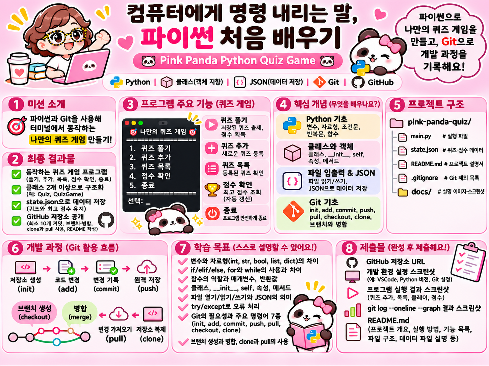
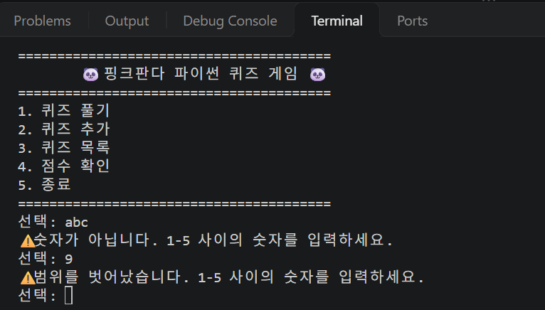
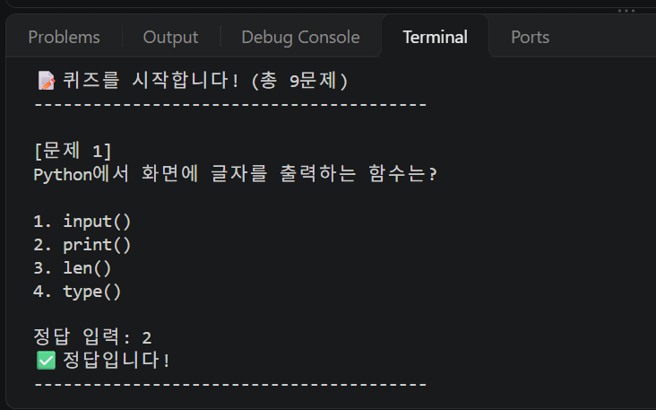
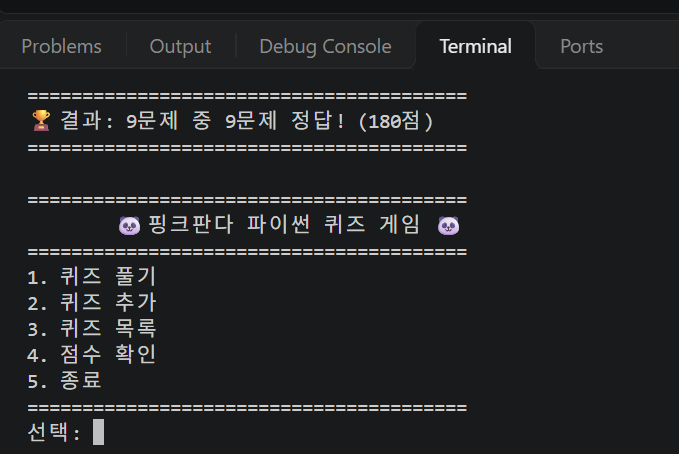
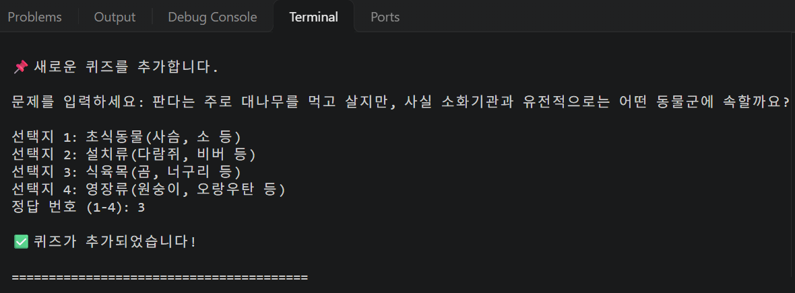
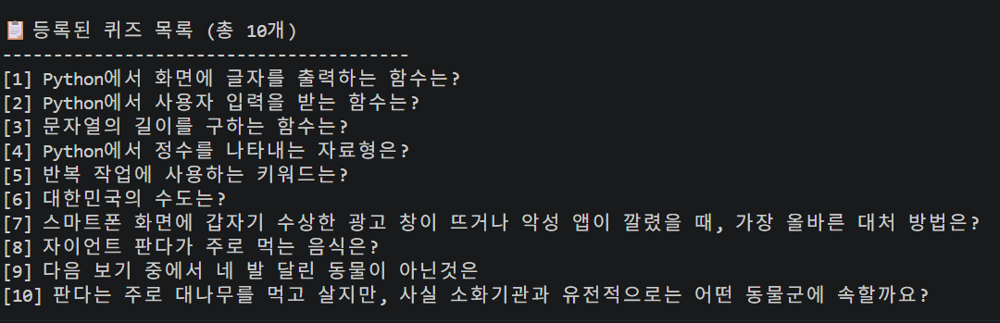
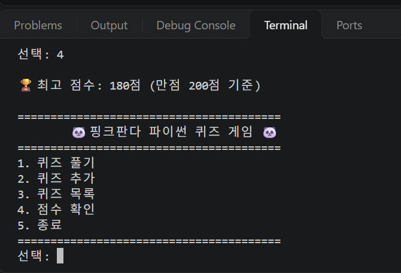

# 🐼 핑크판다 파이썬 퀴즈 게임

컴퓨터에게 명령 내리는 말(파이썬) 처음 배우기 미션

<p align="center">
  
</p>

## 📌 프로젝트 개요

터미널에서 동작하는 **나만의 퀴즈 게임**입니다.
Python 기본 문법으로 입력/출력 흐름을 만들고, `Quiz`, `QuizGame` 클래스로 코드를 역할별로 나눴습니다.
퀴즈와 최고 점수는 `state.json`에 저장해서, 프로그램을 종료하고 다시 실행해도 유지됩니다.
Git으로 기능 단위 커밋과 브랜치 작업을 하고, GitHub에 공개했습니다.

## 🎯 퀴즈 주제 선정 이유

✏️ python과 일반상식 퀴즈 문제를 선택한 이유는 python은 내가 처음 접해보고있어서 퀴즈로 얼마나 알고 있는지 확인을 해보고 싶었고 일반상식은 누구나 알고 있는거지만 그래도 더 잘 알고 싶어서 퀴즈 주제로 선정을 하게 되었습니다.

## 🚀 실행 방법

Python 3.10 이상이 필요하고, 외부 라이브러리는 필요 없습니다.

```bash
git clone https://github.com/jinsoon41088-coder/pink-panda-python-git.git
cd pink-panda-python-git
python main.py
```

## ✨ 기능 목록

| 메뉴 | 기능 |
|---|---|
| 1. 퀴즈 풀기 | 저장된 퀴즈를 차례로 출제하고, 정답/오답과 결과 점수를 보여줍니다. |
| 2. 퀴즈 추가 | 문제, 선택지 4개, 정답 번호를 입력해 새 퀴즈를 등록하고 파일에 저장합니다. |
| 3. 퀴즈 목록 | 등록된 퀴즈 목록을 보여줍니다. |
| 4. 점수 확인 | 최고 점수를 보여줍니다. 퀴즈를 풀 때마다 비교해서 갱신합니다. |
| 5. 종료 | 프로그램을 종료합니다. |

**입력/예외 처리**
- 입력 앞뒤 공백을 제거합니다.
- 빈 입력, 숫자가 아닌 입력(`abc`), 범위 밖 숫자(`9`)는 안내 메시지 후 다시 입력받습니다.
- `Ctrl+C`, 입력 종료(EOF)가 발생해도 비정상 종료하지 않고 저장 후 종료합니다.
- `state.json`이 없으면 기본 퀴즈로 시작하고, 손상되었으면 안내 후 기본 데이터로 복구합니다.
- 퀴즈가 없을 때, 아직 퀴즈를 풀지 않았을 때도 안내 메시지를 보여줍니다.

## 🗂 파일 구조

```
pink-panda-python-git/
├── main.py          # 게임 프로그램 (Quiz, QuizGame 클래스)
├── state.json       # 퀴즈 목록과 최고 점수 저장 파일
├── README.md        # 프로젝트 설명
├── .gitignore
└── screenshots/     # 실행 화면 스크린샷
```

**클래스 구조**
- `Quiz`: 문제 한 개를 표현합니다. 문제 출력(`display`), 정답 확인(`is_correct`), 저장용 변환(`to_dict`, `from_dict`)을 담당합니다.
- `QuizGame`: 게임 전체를 관리합니다. 메뉴 표시, 퀴즈 풀기, 퀴즈 추가, 목록 보기, 점수 확인, 파일 저장/불러오기, 입력 처리를 메서드로 나눴습니다.

## 💾 데이터 파일 (`state.json`)

- **경로**: 프로젝트 루트의 `state.json` (UTF-8)
- **역할**: 퀴즈 목록과 최고 점수를 저장해서 프로그램을 다시 실행해도 유지합니다.

| 키 | 형식 | 설명 |
|---|---|---|
| `high_score` | 정수 | 최고 점수 (정답 1문제당 20점) |
| `quizzes` | 리스트 | 퀴즈 목록 |
| `question` | 문자열 | 문제 |
| `options` | 문자열 4개의 리스트 | 선택지 |
| `answer` | 정수 (1~4) | 정답 번호 |

```json
{
    "high_score": 180,
    "quizzes": [
        {
            "question": "Python에서 정수를 나타내는 자료형은?",
            "options": ["str", "float", "int", "bool"],
            "answer": 3
        }
    ]
}
```

## 📸 실행 화면

**메뉴와 잘못된 입력 처리**



**퀴즈 풀기**



**퀴즈 풀기 결과**



**퀴즈 추가**



**퀴즈 목록**



**점수 확인**



## 🔧 Git 사용 기록


- `init`, `add`, `commit`, `push`를 사용하여 기능 단위로 작업 내용을 기록했습니다.
- `feature/input-validation` 브랜치에서 입력 검증과 구조 개선을 진행한 뒤 `main`에 병합했습니다.
- `feature/quiz-test-report` 브랜치를 생성하여 테스트 결과 문서(`QUIZ_TEST_REPORT.md`)를 작성하고 `main`에 병합했습니다.
- `git clone`으로 GitHub 저장소를 별도 폴더에 복제하는 실습을 완료했습니다.
- 복제한 프로젝트에서 `CLONE_TEST.txt` 파일을 생성하고 `git add`, `git commit`, `git push`를 실행했습니다.
- `git pull`을 실행하여 GitHub 원격 저장소의 변경 사항을 가져오는 실습을 완료했습니다.
