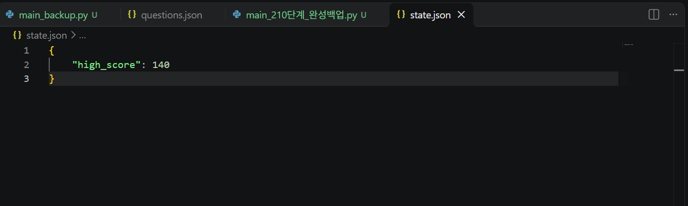

# pink-panda-python-mission
컴퓨터에게 명령 내리는 말(파이썬) 처음 배우기

## 🐼 프로젝트 소개

핑크판다 파이썬 퀴즈 게임은 Python 기초 문법을 활용하여 직접 제작한 퀴즈 프로그램입니다.

### 주요 기능
- 퀴즈 풀기
- 새로운 퀴즈 추가
- 퀴즈 목록 확인
- 최고 점수 확인
- JSON 파일을 이용한 문제 및 최고 점수 저장
- Quiz와 QuizGame 클래스를 활용한 객체 지향 프로그래밍

### 개발 환경
- OS: Windows 11
- Editor: Visual Studio Code
- Language: Python
- Data: JSON
- Version Control: Git / GitHub

---

## 📸 개발 과정 및 실행 결과

### 1. Python 클래스 작성

### 2. 퀴즈 진행 코드

### 3. 퀴즈 실행 결과 - 140점

### 4. 최고 점수 JSON 저장

