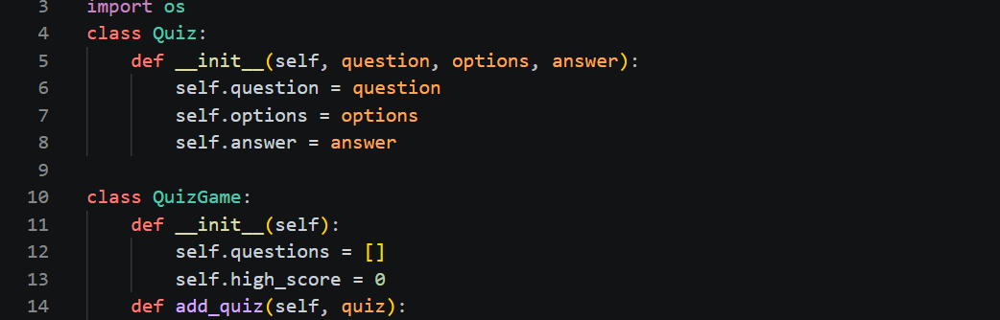
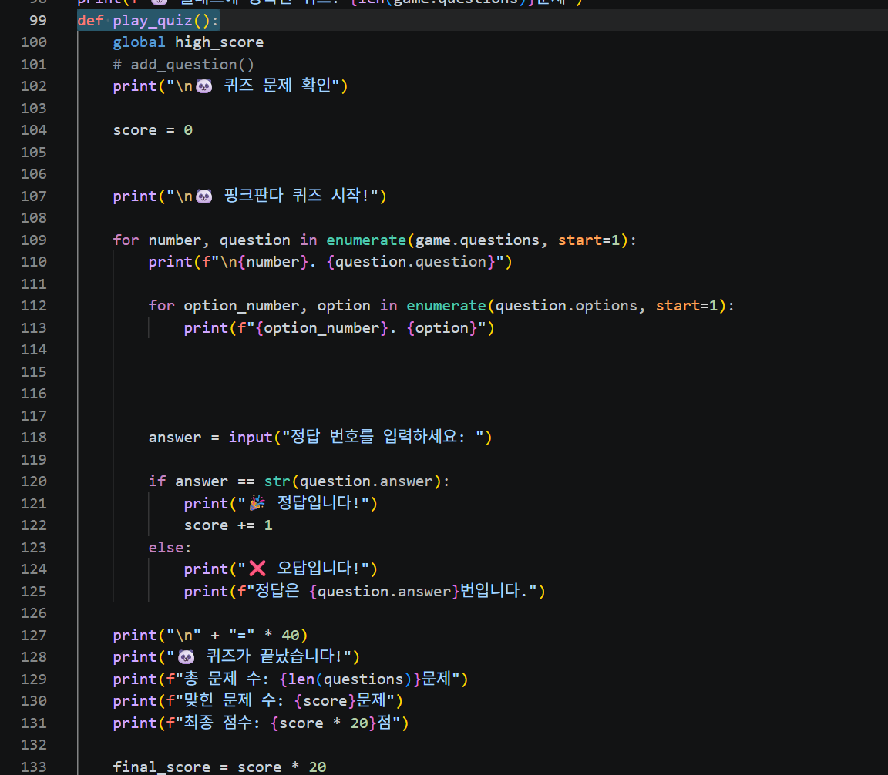
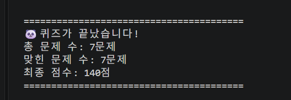

# pink-panda-python-mission
컴퓨터에게 명령 내리는 말(파이썬) 처음 배우기

## 🐼 프로젝트 소개

핑크판다 파이썬 퀴즈 게임은 Python 기초 문법을 활용하여 직접 제작한 퀴즈 프로그램입니다.

### 주요 기능
- 퀴즈 풀기
- 새로운 퀴즈 추가
- 퀴즈 목록 확인
- 최고 점수 확인
- JSON 파일을 이용한 문제 및 최고 점수 저장
- Quiz와 QuizGame 클래스를 활용한 객체 지향 프로그래밍

### 개발 환경
- OS: Windows 11
- Editor: Visual Studio Code
- Language: Python
- Data: JSON
- Version Control: Git / GitHub

---

## 📸 개발 과정 및 실행 결과

### 1. Python 클래스 작성

### 2. 퀴즈 진행 코드

### 3. 퀴즈 실행 결과 - 140점

### 4. 최고 점수 JSON 저장

# pink-panda-python-git
컴퓨터에게 명령 내리는 말(파이썬) 처음 배우기

## 🐼 핑크판다 파이썬 퀴즈 게임 메뉴
### 🎮 게임 메뉴

1. 📝 파이썬 퀴즈 풀기
2. ➕ 퀴즈 추가
3. 📋 추가한 퀴즈 목록
4. 🏆 최고 점수 확인
5. 🚪 퀴즈 종료
### 📋 등록된 퀴즈 목록 (총 9문제)

1. Python에서 화면에 글자를 출력하는 함수는?
2. Python에서 사용자 입력을 받는 함수는?
3. 문자열의 길이를 구하는 함수는?
4. Python에서 정수를 나타내는 자료형은?
5. 반복 작업에 사용하는 키워드는?
6. 대한민국의 수도는?
7. 스마트폰에 수상한 광고나 악성 앱이 나타났을 때 올바른 대처 방법은?
8. 판다가 먹는 음식이 아닌 것은?
9. 다음 보기 중에서 네 발 달린 동물이 아닌 것은?
### 🏆 핑크판다 퀴즈 최고 점수

- 🎯 등록된 퀴즈: 9문제
- 🏆 최고 점수: 180점
- 💾 점수 저장 파일: state.json
- ✅ 프로그램 종료 후에도 최고 점수 유지

## 📸 네이토 파이썬 미션 구현 화면

### 2. 퀴즈 기능 구현

### 3. 파이썬 퀴즈 게임 실행 결과

### 4. JSON 최고 점수 저장

